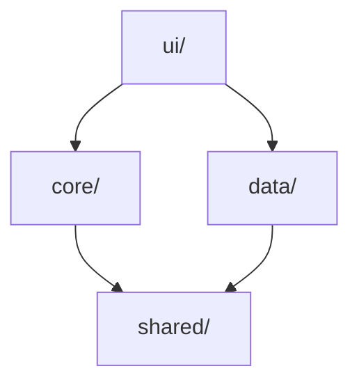
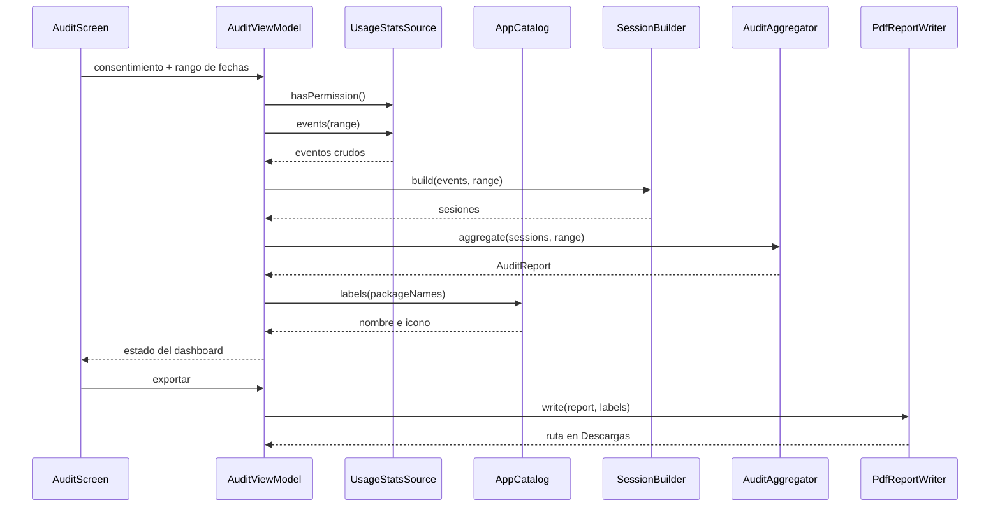

# Arquitectura

Audita la actividad de uso del propio dispositivo Android: lee los eventos que el
sistema guarda sobre qué apps se abrieron y cuándo (`UsageStatsManager`), los
convierte en sesiones con duración, agrega métricas del rango de fechas elegido y
deja el resultado en pantalla y en un PDF en la carpeta Descargas. Todo ocurre en
el dispositivo: la app no declara `INTERNET` y el PDF es el único artefacto.

## Nombre

**Arquitectura en capas con dependencias unidireccionales**, con tres patrones dentro:

| Patrón | Dónde | Qué aporta |
|---|---|---|
| Functional Core, Imperative Shell | `core/` es puro; `ui/` y `data/` hacen el I/O | El cálculo se prueba sin emulador ni mocks |
| MVVM | `ui/`: ViewModel con estado observable + Compose | Patrón de presentación recomendado por Google |
| Capas UI · Dominio · Datos | `ui/` · `core/` · `data/` | Alineado con la guía oficial de arquitectura de Android |

**No es Clean Architecture ni Hexagonal**, aunque comparte con ellas que el núcleo no
depende del framework: las dos exigen inversión de dependencias mediante interfaces
(puertos) definidas en el dominio, y aquí se descartan por haber una sola
implementación de cada fuente (ver *Fuera de alcance*).

## Estructura

```
app/src/main/java/com/example/droidinspector/
├── MainActivity.kt        # entrypoint: tema + pantalla raíz
├── core/                 # lógica de negocio, sin imports de android.*
│   ├── Models.kt          # AuditRange, UsageEvent, UsageBucket, AuditDetail, AuditReport
│   ├── SessionBuilder.kt  # eventos sueltos → sesiones con duración
│   ├── AuditAggregator.kt # sesiones → reporte detallado
│   ├── BucketAggregator.kt# agregados del sistema → reporte resumido
│   └── AuditPlanner.kt    # elige el modo según lo que el dispositivo conserva
├── data/                 # I/O: sistema Android, PDF, archivos
│   ├── UsageStatsSource.kt  # eventos, agregados, permiso y sonda de retención
│   ├── AppCatalog.kt        # nombre e icono por paquete (PackageManager)
│   └── PdfReportWriter.kt   # escribe el PDF vía PdfDocument + MediaStore
├── ui/                   # Compose + ViewModel: conecta core y data
│   ├── AuditViewModel.kt  # orquesta: carga con data, calcula con core
│   ├── AuditScreen.kt     # consentimiento → permiso → rango → dashboard
│   └── theme/             # Color, Theme, Type
└── shared/
    └── Config.kt          # retención de eventos, límites
```

## Capas



- `core/` — lógica de negocio. No importa `data/` ni `android.*`. Recibe datos ya
  cargados, devuelve métricas. Es la capa con tests unitarios.
- `data/` — lectura y escritura (sistema → eventos, reporte → PDF). Sin reglas de negocio.
- `shared/` — valores: límites de retención, formatos. Sin lógica.
- `ui/` — los únicos módulos que conocen `core/` y `data/`. Los conectan. El
  `AuditViewModel` orquesta; los composables solo pintan estado.

## Flujo de la auditoría



Sin permiso de acceso de uso no hay lectura: la UI guía al usuario a Ajustes y reintenta.

## Decisiones

| Decisión | Motivo |
|---|---|
| Un solo módulo Gradle | El proyecto no justifica módulos por capa; las fronteras las impone el paquete |
| Sin interfaces de repositorio | Hay una sola implementación de cada fuente (ver *Fuera de alcance*) |
| Inyección manual por constructor | El grafo es pequeño; Hilt no se gana su lugar |
| Navegación por estado | Cuatro pantallas secuenciales; la librería de navegación no aporta |
| `PdfDocument` del framework | Evita una dependencia de PDF |
| `AuditReport` usa nombres de paquete | `core/` no conoce `PackageManager`; el nombre visible lo resuelve `data/` |
| Retención medida, no cableada | Cada fabricante poda distinto; una constante daría respuestas falsas |
| Buckets repetidos: se toma el máximo | El sistema devuelve el mismo bucket desde memoria y disco; sumarlos infla los totales |
| Selector en modo escritura si no cabe | Con el zoom de pantalla alto quedan ~320 dp y el calendario de Material3 no se dibuja |
| Zona horaria inyectada en `AuditAggregator` | El reparto por día y hora se prueba sin depender de la zona de la máquina |

## Dos modos de auditoría

El sistema retiene los eventos finos unos días, pero conserva **agregados por periodo**
durante meses o años. De ahí dos modos, que el `AuditPlanner` elige según la retención
**medida en el dispositivo** (varía por fabricante: en un Samsung A32 con Android 13 se
midió historial de 13 meses).

| | Detallado | Resumido |
|---|---|---|
| Fuente | `queryEvents` | `queryUsageStats` |
| Alcance | pocos días | meses o años |
| Tiempo por app | sí | sí |
| Último uso | sí | sí |
| Sesiones, horarios, aperturas | sí | **no** |

Reglas que sostienen la credibilidad del reporte:

- **No se prorratea.** Los agregados vienen por bucket completo, así que el total puede
  cubrir más que lo pedido. Se declara el *rango efectivo* junto al solicitado, en pantalla
  y en el PDF, en vez de repartir el total y fingir precisión.
- **No se mezclan modos.** El total por sesiones y el tiempo en primer plano no miden lo
  mismo, así que ni siquiera se llaman igual.
- El tipo `AuditDetail` es sellado: el compilador impide publicar un reporte resumido con
  horarios que nadie midió.

## Fuera de alcance

- I/O dentro de `core/`.
- Reglas de negocio dentro de `data/`.
- Interfaces/abstracciones para una sola implementación.
- Prorratear buckets parciales o estimar horarios en modo resumido.
- Instantáneas periódicas propias: solo servirían hacia adelante y romperían la promesa de
  que el PDF es el único archivo que se crea.
- Capas adicionales a las cuatro de arriba.
- Permiso `INTERNET` y cualquier envío de datos fuera del dispositivo.
